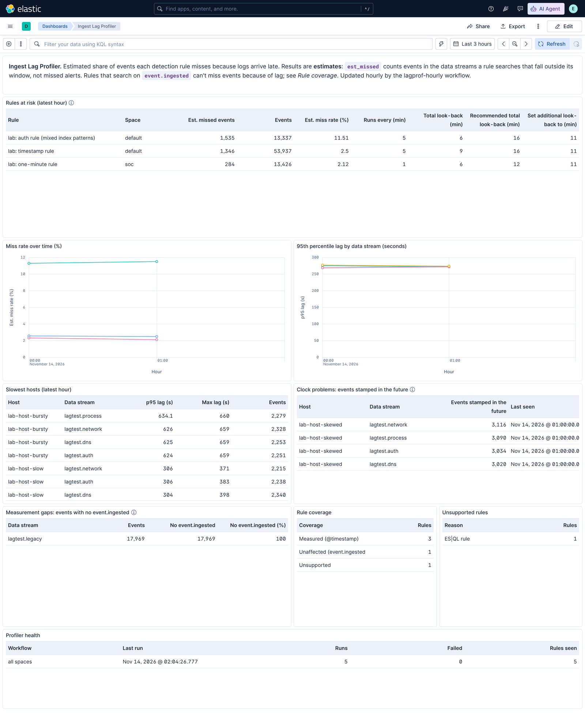

# User guide

How to read the Ingest Lag Profiler's results and what to do about them. To install it, see the [setup guide](setup-guide.md).

---

## What the profiler tells you

A detection rule runs on a schedule. Each run searches a fixed window of time back from when it starts: for example, every 5 minutes, looking back 9 minutes. An event that reaches Elasticsearch **after that window has moved past its timestamp is never searched by that rule.** No error is logged, and no alert fires.

Every hour, the profiler measures how late events arrive, the **lag**: the time between an event's `@timestamp` and its `event.ingested`. It works this out for every data stream your rules search, and then estimates, for each rule:

- **Estimated miss rate:** the share of events in the rule's data streams that arrived too late for the rule to search.
- **Recommended look-back:** a look-back that would bring the estimate under 1%.

It also points to the causes: slow hosts, source systems with wrong clocks, and events that can't be measured.

### How a rule misses an event

With a 5-minute interval and a 9-minute look-back, the rule has a **4-minute safety margin**:

| Event arrives… | Chance the rule misses it |
| --- | --- |
| up to 4 minutes late | 0% |
| 5 minutes late | 20% |
| 7 minutes late | 60% |
| 9 or more minutes late | 100% |

In general, events later than *look-back − interval* start to be missed, and events later than the full look-back are always missed. This was checked against real rules in the lab: the profiler estimated 55.8% against an observed 55.6% ([validation results](validation-results.md)).

### What the numbers are, and aren't

- **They're estimates of searched events, not of missed alerts.** "3% miss rate" means about 3% of the events in the rule's data streams arrived too late to be searched. Whether a missed event would have raised an alert depends on the rule's query.
- **They use the whole data stream's lag.** If the events a rule cares about arrive at a different speed from the rest of the stream, the estimate is off by that difference.
- **Rules that search `event.ingested` can't miss events because of lag.** They search on arrival time, so they aren't estimated. They're counted under *Rule coverage*. About 89% of Elastic's prebuilt rules work this way.
- **Rules that run every minute** may be underestimated slightly, by up to a few points, when Kibana is busy and rule start times vary.

---

## The dashboard

Open **Dashboards › Ingest Lag Profiler**. It shows the last 7 days by default; change the range in the time picker.



### Rules at risk (latest hour)

The panel to act on: rules with an estimated miss rate above 0.1% in the newest hour, sorted by estimated missed events, most first.

| Column | Meaning |
| --- | --- |
| Est. missed events | Expected number of the rule's events in the hour that arrived too late to be checked (`est_missed`, rounded) |
| Events | Events in the hour in the data streams the rule searches |
| Est. miss rate (%) | Est. missed events ÷ Events, across all the rule's data streams |
| Runs every (min) | The rule's interval |
| Total look-back (min) | The rule's whole search window: interval plus additional look-back (the rule's `from`, e.g. `now-6m`) |
| Recommended total look-back (min) | Total look-back that keeps the estimate under 1%, based on the worst hourly 99th-percentile lag in the time range |
| Set additional look-back to (min) | Recommended total look-back − interval: the value to enter in Kibana |

**Missed events or miss rate?** Use both. Missed events shows where the most data goes unchecked: a 2.5% rate on a busy rule can mean as many missed events as 11% on a quiet one. The rate matters for rules that look for rare, high-severity events, where even a few misses count.

**To apply a recommendation:** in Kibana, edit the rule and set **Additional look-back time** to the value in the last column. Kibana asks for the *additional* time, not the total. For example, if a rule runs every 5 minutes and the recommended total is 16, set the additional look-back to 11 minutes. See [Acting on findings](#acting-on-findings) for other options.

### Miss rate over time (%)

The hourly miss rate for each rule. Look for:
- **Steady lines.** A source that's always slow: fix the rule's look-back or the source.
- **Spikes.** A pipeline problem during a particular hour. Compare with the lag panel.

### 95th percentile lag by data stream (seconds)

How late most events in each data stream arrive. 95% of events arrive at or under this line. A rising line is a source or pipeline getting slower, and it often shows up here **before** rules start missing events.

### Slowest hosts (latest hour)

Host and data stream pairs where the 95th percentile lag is over 60 seconds. One slow collector, agent or forwarder usually stands out here.

### Clock problems: events stamped in the future

Hosts sending events stamped more than a minute **after** they arrived. That almost always means the host's clock is wrong. It's worth fixing: wrong timestamps break timelines and correlation, and a host that's *behind* would look like lag instead.

### Measurement gaps: events with no event.ingested

Data streams where some events have no `event.ingested`, so their lag can't be measured. Two consequences:
- These streams are **missing from the miss-rate estimates**.
- Rules that search `event.ingested` **fall back to `@timestamp` for these events**, so lag *can* make those rules miss them.

### Rule coverage

How your enabled rules split:

| Group | Meaning |
| --- | --- |
| **Measured (@timestamp)** | Lag can cause misses; these rules are estimated |
| **Unaffected (event.ingested)** | Lag can't cause misses |
| **Unsupported** | The profiler can't estimate them; see the next panel |

A short *Rules at risk* list next to a large *Unaffected* count is a healthy result, not a broken tool.

### Unsupported rules

Rules the profiler can't estimate, and why:
- machine learning rules
- ES|QL rules
- rules that use a data view
- rules whose index patterns only point at remote clusters

### Profiler health

The last run, the number of runs and failures, and the rules seen, for each workflow. If *Last run* is more than an hour or two old, see [When the profiler stops](#when-the-profiler-stops).

---

## Acting on findings

### A rule is at risk

Choose one of three fixes:

| Fix | When to choose it | Trade-off |
| --- | --- | --- |
| **Raise the look-back** to the recommendation | The source is slow but reliable | Each run searches more data. Elastic doesn't raise duplicate alerts for the same event from overlapping windows. |
| **Search `event.ingested` instead** (Timestamp override in the rule's settings) | Lag varies a lot, or can't be fixed | The rule's window then follows arrival time. Events without `event.ingested` fall back to `@timestamp`. Check that time-based logic, such as EQL sequences and thresholds, still behaves as intended. |
| **Fix the source** | Lag comes from one host, collector or pipeline (see *Slowest hosts*) | Fixes every rule on that source at once. |

Editing a prebuilt rule turns it into a customized rule, which you then maintain.

### A host is slow

Look at the agent or collector on that host first: its health, queue or backlog, resources, and network path. Then look at anything in between, such as Logstash, a message queue or an ingest pipeline. Check whether every data stream from that host is slow (a host or network problem) or only one (an integration or pipeline problem).

### A host's clock is wrong

Fix time synchronization (NTP or chrony) on the host. Until then, its events have unreliable timestamps everywhere, not just in this tool.

### Events have no event.ingested

Elastic Agent integrations set `event.ingested`. Other ingest paths, such as custom pipelines, Logstash or direct API writes, may not. To set it, add a **final pipeline** to those data streams with one `set` processor:

```json
{ "set": { "field": "event.ingested", "value": "{{{_ingest.timestamp}}}" } }
```

---

## Alerts

| Alert | Fires when | Respond by |
| --- | --- | --- |
| **Rule miss rate above 1%** | Any rule's estimate in the latest hour is above 1% (checked every 15 minutes) | Open *Rules at risk*, find the cause on the lag and host panels, and pick a fix from the table above |
| **No successful run in 3 hours** | A profiler workflow has stopped succeeding (checked every 30 minutes) | See [When the profiler stops](#when-the-profiler-stops) |

The setup guide covers [sending alerts](setup-guide.md#9-send-alerts-somewhere) and changing the threshold.

## When the profiler stops

1. In Kibana, open **Workflows › lagprof-hourly-… › Executions** and open the failed run. The error names the step that failed.
2. The usual causes:
   - The workflow was disabled.
   - Its owner's API key expired or was deleted. Recreate it as in [setup step 7](setup-guide.md#7-give-the-workflow-its-own-limited-identity).
   - A failed write, such as `rule_bulk_write_failed…`. Run `install` again.
   - A license change.
3. `python3 scripts/lagprof.py status --target-file <your target>` shows whether anything has drifted from the pack.

---

## A suggested routine

| When | What |
| --- | --- |
| **When the miss-rate alert fires** | Work through *Rules at risk* as above |
| **Weekly** | Scan the lag trend for slow drift, and check *Measurement gaps* and *Clock problems* |
| **After onboarding a new data source** | Check its lag and gaps after the first full hour |
| **After changing rules or pipelines** | Watch the next few hourly results |
| **Monthly or quarterly** | Report the share of measured rules under 1%, and the trend, as a coverage measure |

## Where the data lives

Results are kept as ordinary indices you can query, chart or export. The [field reference](fields.md) describes every field.

| Index | Contents | Kept for |
| --- | --- | --- |
| `lagprof-results` | Miss rate per rule, data stream and hour | 90 days |
| `lagprof-stream-stats` | Lag, gaps and clock problems per data stream and hour | 90 days |
| `lagprof-host-lag` | Slow or skewed hosts per hour | 30 days |
| `lagprof-runs` | One record per workflow run | 90 days |
| `lagprof-rules` | Current rule inventory | rebuilt hourly |
