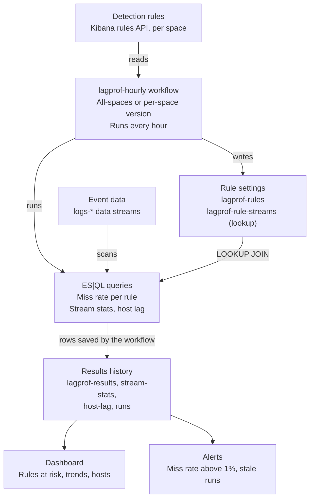

# Ingest Lag Profiler Design

Nov 13, 2026 · @tammy · revised Nov 13, 2026 with the build plan review · updated Nov 14, 2026 to match the code at v0.1.0-dev

This document describes the pack **as built**. Where the build changed the original plan, the text follows the code, and [build-plan.md](build-plan.md) records why. Reviewers should start with [Notes for reviewers](#notes-for-reviewers) near the end.

The Ingest Lag Profiler estimates how many events each Elastic Security detection rule misses because logs arrive late. It runs entirely inside Elastic. It targets **Elastic Stack 9.5.6 with an Enterprise license**, and the installer can also load it into Elastic Cloud and Serverless projects. It ships as a pack: a workflow (in two versions), index templates, ingest pipelines, queries, a dashboard and alert rules. One installer script loads all of it, and nothing keeps running outside Elastic.

Key decisions:

- **Workflows schedules and orchestrates.** Workflows has been generally available since 9.4 and needs an Enterprise license.
- **ES|QL does the math.** One query counts events per data stream and lag second, joins those counts to rule settings with `LOOKUP JOIN`, and estimates a miss rate per rule and data stream.
- **An index is the record.** Each hourly run writes its results to history indices, which the dashboard and alerts read.
- **Estimates, not proof.** The profiler reports an expected miss rate from measured lag. A lab test checks the method before anyone relies on it.
- **Two workflow versions for Kibana spaces.** One workflow covers every space, or one copy runs in each space. The user chooses.
- **One installer for every deployment type.** The same resource files load into a local lab on Rancher Desktop, a self-managed cluster, Elastic Cloud or Serverless.

## Problem, goals and non-goals

A rule searches a fixed window back from each run. An event that arrives after the window has passed its timestamp is never searched, and nothing reports an error. Teams rarely measure this, so look-back settings are often guesses.

**Who this matters for.** Many of Elastic's prebuilt rules search on `event.ingested`, the time an event arrived, instead of `@timestamp`. Lag can't push an event out of their window. The rules at risk are mostly custom, third-party and imported rules that search on `@timestamp`. The profiler shows how many rules fall into each group, so a short "Rules at risk" list reads as good news rather than as a broken tool. Rules that search on `event.ingested` still fall back to `@timestamp` for events that have no ingest time. For those rules, events with no ingest time are the risk, and the profiler counts them.

**Goals**

1. Measure ingest lag for every data stream that enabled rules search.
2. Estimate each rule's miss rate from that lag and the rule's interval and look-back.
3. Show lag by host, so one slow collector stands out.
4. Flag clock problems on source systems, by host and by data stream.
5. Recommend a look-back that keeps each rule under a target miss rate.
6. Keep a history and alert when a miss rate passes a threshold.
7. Work across Kibana spaces.

**Non-goals for the first version**

- Changing rules automatically. The profiler recommends, and a person decides.
- Supporting machine learning rules, which don't use this kind of search window.
- Parsing ES|QL rule queries to find their indices. These rules are listed as unsupported.
- Resolving data views to index patterns. Rules that use a data view are listed as unsupported.
- Measuring delay that happens before an event's `@timestamp` is set, for example when a collector stamps events on receipt rather than when they happened. The profiler only sees lag between `@timestamp` and `event.ingested`.
- A free edition for licenses without Workflows.

### What the estimate means

`est_missed` is the expected number of *events in the data streams a rule searches* that fall outside the rule's window. It is not a count of missed alerts. The rule's own query filter, such as `event.category:process`, isn't applied, so a stream's overall lag stands in for the lag of the events the rule matches. For threshold rules, a late event lowers a count rather than removing a whole alert. For new terms rules, a late event can also cause a false positive, because a term that arrives late looks new. The README and the dashboard both say this.

## When a rule misses a late event

A rule is guaranteed to catch an event only when its lag is no more than the look-back minus the interval. Above that, the chance of a miss rises in a straight line until it reaches certainty at the full look-back.

For a rule with interval *I*, look-back *L* and an event with lag *d*:

```latex
P(\text{miss}) = \min\left(1,\ \max\left(0,\ \frac{d - (L - I)}{I}\right)\right)
```

**Why:** the first run after the event arrives falls somewhere in the next interval. That run catches the event only if its window still reaches back to the event's timestamp. Later runs start their windows even later, so they never catch an event that the first run missed.

Worked example for a rule that runs every 5 minutes and looks back 9 minutes, so the safe margin is 4 minutes:

| Lag | Chance of a miss |
| --- | --- |
| 3 minutes | 0% |
| 5 minutes | 20% |
| 7 minutes | 60% |
| 9 minutes or more | 100% |

The model assumes that arrival times are spread evenly against the rule's schedule. It ignores index refresh delay, which is normally about a second, and delays in rule execution. A run that starts late or fails creates a gap, which Elastic's own gap detection already covers. I derived this formula rather than taking it from a source. A computer simulation confirms it: all 34 test points match within 4 standard errors. The lab test then checks it against real rules. The simulation also shows that runs starting late shrink the safe margin by about the length of the delay. That adds up to about *delay ÷ interval* to the miss rate near the edge of the margin, which matters for 1-minute rules only. Details are in [docs/miss-model.md](docs/miss-model.md).

## Architecture



The workflow is the only moving part. Everything it reads or writes is an ordinary index, so the dashboard and alerts keep working from history even if a run fails.

## Data model

The profiler uses six indices, all prefixed `lagprof-`. Two describe rules, three hold results, and one logs each run.

| Index | Type | One document per | Read by |
| --- | --- | --- | --- |
| `lagprof-rules` | Standard index | Enabled rule | Dashboard (rule coverage) |
| `lagprof-rule-streams` | Lookup index (`index.mode: lookup`) | Rule and data stream pair | Miss-rate query |
| `lagprof-results` | Data stream, 90-day retention | Rule, data stream and hour | Dashboard, miss-rate alert |
| `lagprof-stream-stats` | Data stream, 90-day retention | Data stream and hour | Dashboard (lag by stream, clock problems, measurement gaps) |
| `lagprof-host-lag` | Data stream, 30-day retention | Data stream, host and hour, for slow or skewed hosts only | Dashboard |
| `lagprof-runs` | Data stream, 90-day retention | Workflow run | Dashboard (health), stale-profiler alert |

The workflow writes all of them. Retention uses data stream lifecycle, not ILM, so the same templates work on Serverless.

`lagprof-rule-streams` has its **own small mapping**; every other index uses the shared `lagprof-common` component template. `LOOKUP JOIN` adds every field the lookup index maps, and a lookup field replaces any query column with the same name. Sharing the results mapping caused exactly that bug in the lab: empty result fields replaced the query's percentile columns.

Two safeguards follow from this:
- `lagprof.py lint` fails if the lookup mapping shares a name with a column the miss-rate query creates before its join.
- The installer recreates the lookup index when its mapping is out of date. Every run rebuilds it, so nothing lasting is lost.

### Naming

- Profiler fields live under `lagprof.`, such as `lagprof.rule.id`, `lagprof.space.id`, `lagprof.run.id` and `lagprof.window.start`. Firewall, IDS and proxy logs already use ECS `rule.id` and `rule.name`, and `LOOKUP JOIN` would overwrite those if the lookup used the same names.
- ECS fields keep their ECS names: `@timestamp`, `data_stream.*` and `host.name`.
- Measurements are flat: `events`, `miss_rate_pct` and so on.

### Key fields

**`lagprof-rules`**:
- `@timestamp` (when the run saw the rule, set by `lagprof-rules-parse` so time-filtered dashboard panels show rules), `lagprof.run.id`, `lagprof.space.id`
- `lagprof.rule.`: `id`, `rule_id`, `name`, `type`, `interval_raw` (for example `5m`), `from_raw` (for example `now-9m`), `interval_s`, `lookback_s`, `index_patterns`, `index_patterns_csv`, `remote_patterns_skipped`, `data_view_id`, `timestamp_override`, `timestamp_override_fallback_disabled`, `timestamp_field`, `supported`, `unsupported_reason`

**`lagprof-rule-streams`**:
- The join keys: `data_stream.dataset` and `data_stream.namespace`
- `data_stream.name`, `data_stream.type`, `lagprof.run.id`, `lagprof.space.id`, `lagprof.parse_error`
- `lagprof.rule.`: `id`, `name`, `interval_s`, `lookback_s`, `timestamp_field`

The document ID is the rule ID plus the data stream name, so a rerun overwrites rather than duplicates.

**`lagprof-results`**:
- `@timestamp` (the start of the hour measured), `lagprof.window.start`, `lagprof.run.id`, `lagprof.space.id`
- `lagprof.rule.`: `id`, `name`, `interval_s`, `lookback_s`
- `data_stream.dataset`, `data_stream.namespace`
- Measurements: `events`, `est_missed`, `miss_rate_pct`, `lag_p50_s`, `lag_p95_s`, `lag_p99_s`, `lag_max_s`, `negative_lag_events`, `recommended_lookback_s`

**`lagprof-stream-stats`**:
- `@timestamp`, `lagprof.window.start`, `lagprof.run.id`
- `data_stream.dataset`, `data_stream.namespace`
- Measurements: `events`, `unmeasured_events`, `lag_p50_s`, `lag_p95_s`, `lag_p99_s`, `lag_max_s`, `negative_lag_events`

**`lagprof-host-lag`**:
- `@timestamp`, `lagprof.window.start`, `lagprof.run.id`
- `data_stream.dataset`, `data_stream.namespace`, `host.name`
- Measurements: `events`, `lag_p95_s`, `lag_max_s`, `negative_lag_events`

**`lagprof-runs`**:
- `@timestamp`, `lagprof.run.id`, `lagprof.mode` (`all-spaces` or `per-space`)
- `lagprof.space.id` and `lagprof.wrote_shared_stats`, in per-space mode only
- `spaces_with_rules`, in all-spaces mode only
- `rules_seen`, `rules_supported`, `streams_matched`, `result_rows`
- `status`: `success`, `no_data` (the run worked but `logs-*` is empty or has no `event.ingested`) or `failed`
- `reason` for `no_data` runs, and `error` for `failed` runs

Result documents get IDs built from the hour, the rule and the data stream, and are written as bulk create operations. Running the same hour again therefore skips existing rows rather than duplicating them. Data streams only accept create operations anyway.

### Ingest pipelines

Pipelines do the parsing, because workflow templates aren't a good place for arithmetic.

**`lagprof-rules-parse`** does all of the following:
- Converts an interval such as `5m`, `1h` or `30s` into seconds, and converts `now-9m` into a look-back in seconds.
- Sets `lagprof.rule.timestamp_field` to the rule's timestamp override, or to `@timestamp` when there is none.
- Joins the index patterns into `index_patterns_csv` for the resolve call.
- Drops remote cluster patterns (`cluster:index`) from `index_patterns_csv` and sets `remote_patterns_skipped`. The local patterns are still measured.
- Marks these rules unsupported, with a reason:
  - machine learning and ES|QL rules
  - rules that use a data view, which this version doesn't resolve
  - rules whose patterns all point at remote clusters, or that have no patterns
  - `interval` or `from` values it can't parse
- Treats the empty values that workflow templates produce for missing fields (`""`, `"null"`, `"[]"` and so on) as missing.
- If the script throws, its `on_failure` handler marks the rule unsupported with the error as the reason, so one odd rule can't fail a run.

**`lagprof-streams-parse`** splits a data stream name such as `logs-system.security-default` into type, dataset and namespace. Data stream names follow the type-dataset-namespace pattern, and neither datasets nor namespaces contain hyphens, so a dissect plus a check that the namespace has no hyphen is enough. A name that doesn't fit is **kept** with `lagprof.parse_error` set and no dataset or namespace, so it never joins. That way one odd name can't fail the whole bulk request and stop the run.

**`lagprof-stamp`** sets `@timestamp` to the arrival time on run summary documents.

## Workflow design

The workflow runs every hour. Hourly is far above the 1-minute minimum, and frequent enough to catch an outage the same day.

### Two versions for Kibana spaces

Detection rules and workflows both belong to a Kibana space. The rules API only returns rules from one space at a time. The pack ships two versions, and the user installs one of them:

| | All spaces | Per space |
| --- | --- | --- |
| File | `kibana/workflows/lagprof-hourly-all-spaces.yaml` | `kibana/workflows/lagprof-hourly-per-space.yaml` |
| Copies | One, in the Default space | One in each space with rules |
| Finds spaces | Automatically, every run | You install a copy in each space and set its `space_id` |
| Role | Reads rules in every space | Each copy reads only its own space |
| Scans of `logs-*` per hour | 3 | One per space, plus 2 for shared stats |
| Best for | Most deployments | Managed providers and spaces owned by separate teams |

Raw logs aren't divided by space, so stream stats and host lag are the same for every space. In per-space mode, exactly one copy writes them, chosen with `write_shared_stats: true`. Each copy's stale-data cleanup only touches its own space. [kibana/workflows/README.md](kibana/workflows/README.md) has the full comparison and install steps.

### Stages

Both versions run the same stages:

1. **Collect rules.** `kibana.request` calls the rules find API for enabled rules, with `per_page=10000` and one page only. That step sets `max-step-size: 64mb`, because the default 10 MB output limit fails at about 2,300 rules. The all-spaces version first lists the spaces and repeats this for each one, using `/s/<space>/` paths. A space with more than 10,000 enabled rules would be cut off at 10,000 (see [Still open](#still-open)).
2. **Save rule settings.** One bulk request per space writes the rules to `lagprof-rules` through `lagprof-rules-parse`, with `refresh=wait_for`. An `if` step then checks the bulk response's `errors` flag and, if it's set, calls a path that doesn't exist on purpose, so the run fails and the fallback records why. Only the rules the pipeline marked supported are read back.
3. **Expand index patterns.** For each supported rule, one `_resolve/index` call covers all its local patterns. Only the `data_streams` part of the response is used, so backing `.ds-` indices, aliases and plain indices are ignored. One bulk request per rule writes a pair for each data stream to `lagprof-rule-streams`, with the same error check as stage 2. The index is then refreshed so the query can see the new pairs. Missing indices in a rule's patterns are ignored.
4. **Remove stale documents.** A delete-by-query removes documents from earlier runs from both rule indices, which drops disabled and deleted rules. In per-space mode, it only touches its own space. This stage only runs if stages 1 to 3 succeeded. A partial run never deletes good pairs.
5. **Count and check for data.** Two searches count this run's rules and pairs for the run summary. Two more searches with `terminate_after: 1` check that `logs-*` has any documents, and any with `event.ingested`. ES|QL rejects a query that names a column no index maps, so on a new cluster the queries would fail every run. If nothing is measurable, the run writes a `no_data` summary with a plain-words `reason` and stops.
6. **Run the queries.** The workflow posts the miss-rate, stream-stats and host-lag queries to the ES|QL API. In per-space mode, only the copy with `write_shared_stats: true` runs the last two.
7. **Save results.** One bulk request per query writes the rows as create operations, and a final step writes the `success` run summary. If any step fails, a workflow-level fallback writes a `failed` run summary with `error.message` instead.

Every write and query uses the generic `elasticsearch.request` step. A workflow's scheduled runs use the permissions of the account that last saved it, so the installer saves it with a dedicated low-privilege user's API key when one is given. See "Privileges".

- **Bulk bodies.** Each bulk body is built with a Liquid `` loop, and values go through the `json` filter, which escapes strings and writes arrays, numbers and nulls.
- **Fixed column order.** ES|QL returns rows as arrays by position, so every query ends with an explicit `KEEP`.
- **Never-empty bodies.** Each bulk body starts with a delete of a document ID that never exists (`__lagprof_noop__`), so the request is valid even when a query returns no rows.
- **Safe reruns.** Bulk reports problems per document instead of failing the step. Rerunning an hour therefore skips rows that already exist. Rule and pair writes are checked (stage 2 and 3), but result writes aren't, because a rerun causes expected duplicate errors. So a mapping error in a result write would go unnoticed; compare `result_rows` in the run summary with the documents written.

The two YAML files are the reference. Both have run successfully in the 9.5.6 lab, including the per-space shared-stats switch. The installer imports them through the Workflows API. Kibana runs a newly created scheduled workflow once straight away.

## Queries

Three ES|QL queries run each hour. They measure the **last full clock hour**, so back-to-back runs neither overlap nor leave gaps, and they need no parameters from the workflow. Each query also limits `@timestamp` to the last 25 hours, so the scan can skip older backing indices. Events more than 24 hours late are dropped, and every rule misses those anyway.

### Miss rate per rule

The query counts events per data stream and lag second first, then joins rules to those counts. Joining raw events would copy every event once per rule. Every event with the same lag has the same chance of a miss, so the estimate is exact. Each event searched by three rules still counts once for each. Lags over 2 hours are grouped by whole minute to keep the row count down. That only matters for rules whose look-back is over 2 hours, where it can shift a miss chance by up to 60 seconds ÷ interval. Percentiles are computed once per stream on the raw events with `INLINE STATS`. Their columns (`stream_p50` and so on) are named so they don't collide with fields mapped in the lookup index, which would replace them in the join. Rows with no matching rule are dropped. Rules that search on `event.ingested` are left out here, because ingest lag doesn't affect them. The per-space version adds `lagprof.space.id == ?space_id` to the `WHERE` after the join.

[esql/miss-rate.esql](esql/miss-rate.esql) is the reference copy; `lagprof.py lint` checks that it matches both workflows.

```sql
FROM logs-*
| WHERE @timestamp >= DATE_TRUNC(1 hour, NOW()) - 25 hours
    AND event.ingested >= DATE_TRUNC(1 hour, NOW()) - 1 hour
    AND event.ingested <  DATE_TRUNC(1 hour, NOW())
| EVAL lag_s = DATE_DIFF("seconds", @timestamp, event.ingested)
| INLINE STATS stream_p50 = PERCENTILE(lag_s, 50),
               stream_p95 = PERCENTILE(lag_s, 95),
               stream_p99 = PERCENTILE(lag_s, 99),
               stream_max = MAX(lag_s)
     BY data_stream.dataset, data_stream.namespace
| EVAL lag_s = CASE(lag_s > 7200, lag_s - lag_s % 60, lag_s)
| STATS n = COUNT(*)
     BY data_stream.dataset, data_stream.namespace, lag_s,
        stream_p50, stream_p95, stream_p99, stream_max
| LOOKUP JOIN lagprof-rule-streams ON data_stream.dataset, data_stream.namespace
| WHERE lagprof.rule.id IS NOT NULL AND lagprof.rule.timestamp_field == "@timestamp"
| EVAL margin_s = lagprof.rule.lookback_s - lagprof.rule.interval_s
| EVAL miss = CASE(lag_s <= margin_s, 0.0,
                   lag_s >= lagprof.rule.lookback_s, 1.0,
                   TO_DOUBLE(lag_s - margin_s) / lagprof.rule.interval_s)
| STATS events = SUM(n),
        est_missed = SUM(n * miss),
        negative_lag_events = SUM(CASE(lag_s < -60, n, 0)),
        lag_p50_s = MAX(stream_p50),
        lag_p95_s = MAX(stream_p95),
        lag_p99_s = MAX(stream_p99),
        lag_max_s = MAX(stream_max)
     BY lagprof.space.id, lagprof.rule.id, lagprof.rule.name,
        lagprof.rule.interval_s, lagprof.rule.lookback_s,
        data_stream.dataset, data_stream.namespace
| EVAL window_start = DATE_TRUNC(1 hour, NOW()) - 1 hour,
       miss_rate_pct = ROUND(est_missed / events * 100, 2),
       recommended_lookback_s = GREATEST(
         lagprof.rule.interval_s + 60,
         lagprof.rule.interval_s + TO_INTEGER(CEIL(lag_p99_s / 60.0)) * 60)
| KEEP window_start, lagprof.space.id, lagprof.rule.id, lagprof.rule.name,
       lagprof.rule.interval_s, lagprof.rule.lookback_s,
       data_stream.dataset, data_stream.namespace,
       events, est_missed, miss_rate_pct,
       lag_p50_s, lag_p95_s, lag_p99_s, lag_max_s,
       negative_lag_events, recommended_lookback_s
| SORT miss_rate_pct DESC
| LIMIT 10000
```

**Recommended look-back.** The query recommends the interval plus the 99th percentile of lag, rounded up to a whole minute. By the formula above, that keeps the estimated miss rate under 1%. The floor of one minute above the interval stops clock problems, which show up as negative lag, from producing a look-back shorter than the interval. One hour's 99th percentile is noisy, so the dashboard's recommendation per rule uses the highest hourly value across all the rule's data streams in the dashboard's time range, which is 7 days by default.

`LIMIT 10000` matters because ES|QL returns only 1,000 rows by default.

### Stream stats

There is one row per data stream. Events with an ingest time are placed by when they arrived. Events without one can only be placed by `@timestamp`, so the query selects each kind by its own time.

```sql
FROM logs-*
| WHERE @timestamp >= DATE_TRUNC(1 hour, NOW()) - 25 hours
| WHERE (event.ingested >= DATE_TRUNC(1 hour, NOW()) - 1 hour
         AND event.ingested < DATE_TRUNC(1 hour, NOW()))
     OR (event.ingested IS NULL
         AND @timestamp >= DATE_TRUNC(1 hour, NOW()) - 1 hour
         AND @timestamp < DATE_TRUNC(1 hour, NOW()))
| EVAL lag_s = DATE_DIFF("seconds", @timestamp, event.ingested)
| STATS events = COUNT(*),
        measured_events = COUNT(event.ingested),
        lag_p50_s = PERCENTILE(lag_s, 50),
        lag_p95_s = PERCENTILE(lag_s, 95),
        lag_p99_s = PERCENTILE(lag_s, 99),
        lag_max_s = MAX(lag_s),
        negative_lag_events = SUM(CASE(lag_s < -60, 1, 0))
     BY data_stream.dataset, data_stream.namespace
| EVAL window_start = DATE_TRUNC(1 hour, NOW()) - 1 hour,
       unmeasured_events = events - measured_events
| KEEP window_start, data_stream.dataset, data_stream.namespace,
       events, unmeasured_events,
       lag_p50_s, lag_p95_s, lag_p99_s, lag_max_s, negative_lag_events
| LIMIT 10000
```

This one query feeds the lag-by-stream, clock-problem and measurement-gap panels. Because it has one row per stream, a stream that several rules search is counted once.

### Lag by host

The query keeps hosts that are slow, or whose clocks are ahead. A filter on high lag alone would hide the clock problems.

```sql
FROM logs-*
| WHERE @timestamp >= DATE_TRUNC(1 hour, NOW()) - 25 hours
    AND event.ingested >= DATE_TRUNC(1 hour, NOW()) - 1 hour
    AND event.ingested <  DATE_TRUNC(1 hour, NOW())
| EVAL lag_s = DATE_DIFF("seconds", @timestamp, event.ingested)
| STATS events = COUNT(*),
        lag_p95_s = PERCENTILE(lag_s, 95),
        lag_max_s = MAX(lag_s),
        negative_lag_events = SUM(CASE(lag_s < -60, 1, 0))
     BY data_stream.dataset, data_stream.namespace, host.name
| WHERE lag_p95_s > 60 OR negative_lag_events > 0
| EVAL window_start = DATE_TRUNC(1 hour, NOW()) - 1 hour
| KEEP window_start, data_stream.dataset, data_stream.namespace, host.name,
       events, lag_p95_s, lag_max_s, negative_lag_events
| SORT lag_p95_s DESC
| LIMIT 10000
```

**Clock problems** show up as `negative_lag_events`: events stamped more than a minute after they arrived. That usually means a source system's clock is wrong.

**Cost (measured in the lab, single node, 8 GB VM).** The query's time grows with event volume, about **1 second per million events in the hour**, and doesn't depend on how many rules search a stream:

| Events in the hour | Rules per stream | Query time |
| --- | ---: | ---: |
| 3 million | 1 | 3.0 s |
| 3 million | 20 | 2.9 s |
| 3 million | 50 | 3.8 s |

The first version joined raw events to rules. It took 63 seconds for 3 million events with one rule, and grew with every extra rule. Larger clusters spread the scan across nodes. The per-space version repeats the miss-rate scan once for each space.

## Dashboard and alerting

The dashboard answers one question first: which rules are missing events right now? Detail panels sit below it. Every panel reads the `lagprof-` indices, never raw logs, so the dashboard stays fast and shows history. Panels use ES|QL and see the dashboard's time range (7 days by default) on `@timestamp`. "Latest hour" panels pick the newest window in that range with `INLINE STATS latest = MAX(lagprof.window.start)`.

[kibana/dashboards/build.py](kibana/dashboards/build.py) holds the panel queries in readable form and writes `lagprof-overview.json`, a Dashboards API body. Edit `build.py`, not the JSON; `make dashboard` runs every query against the lab first. It has ten panels:

| Panel | Shows | Source |
| --- | --- | --- |
| Note (markdown) | What the estimate means (see [What the estimate means](#what-the-estimate-means)) | — |
| Rules at risk (latest hour) | Rules with an estimated miss rate above 0.1% in the newest hour, rolled up per rule as total missed over total events, sorted by estimated missed events. Shows interval, current total look-back, recommended total look-back, and the additional look-back to enter in Kibana. | `lagprof-results` |
| Miss rate over time (%) | Hourly miss rate per rule | `lagprof-results` |
| 95th percentile lag by data stream | Highest hourly p95 lag per dataset over time | `lagprof-stream-stats` |
| Slowest hosts (latest hour) | Host and dataset pairs with p95 lag above 60 seconds | `lagprof-host-lag` |
| Clock problems | Hosts with events stamped more than a minute in the future | `lagprof-host-lag` |
| Measurement gaps | Datasets with events that have no `event.ingested`, with counts and share | `lagprof-stream-stats` |
| Rule coverage | Rules that are measured (`@timestamp`), unaffected (`event.ingested`) or unsupported | `lagprof-rules` |
| Unsupported rules | Unsupported rules counted by reason | `lagprof-rules` |
| Profiler health | Per workflow: last run, last status and note, runs, `no_data` and failed counts, rules seen | `lagprof-runs` |

Differences from the original plan: the clock problems panel shows hosts only (stream-level `negative_lag_events` is stored but not charted); measurement gaps doesn't list the rules that search each stream; and miss rate over time shows every rule rather than the top 10. Results carry `lagprof.space.id`, so the dashboard can be filtered by space. A per-space install gets its own copy titled *Ingest Lag Profiler (<space>)*, but its queries aren't limited to that space.

**Alerts.** Two Kibana alerting rules, both using ES|QL, watch the results:

- **Miss rate:** alerts when any rule's estimated miss rate in the latest hour goes above 1%. The rate is rolled up per rule across its data streams. The threshold is one value in the query and easy to change.
- **Stale profiler:** alerts when `lagprof-runs` has no completed run (`success` or `no_data`) in the last 3 hours, so a broken workflow can't go unnoticed. In per-space mode, it checks each space.

The history in `lagprof-results` is the preserved report. Exported reports from the dashboard are optional, and I didn't confirm which licenses include scheduled PDF reporting.

## Deployment targets and installer

The pack loads into four kinds of deployment. The resource files (templates, pipelines, queries, workflows, dashboard and alert rules) are the same for all four. Differences are handled by the installer, not by separate copies of the files.

| | Lab (Rancher Desktop) | Self-managed | Elastic Cloud (hosted) | Serverless |
| --- | --- | --- | --- | --- |
| Use | Development and validation | Customer clusters | Hosted deployments | Security projects |
| Version | 9.5.6, pinned in the Compose file | 9.5.6 or later | 9.5.6 or later | No version; tested by date |
| License | Trial, started by the lab script | Enterprise or trial | Enterprise | No license; project type and tier apply (**verify** that Workflows is available) |
| Connection | `localhost`, `elastic` user from the lab's `.env` | URLs, API key or user and password, optional CA certificate | Cloud ID or URLs, API key | Project URLs, API key |
| Role | Kibana role API | Kibana role API | Kibana role API | Kibana role API if custom roles are available (**verify**); otherwise the installer prints manual steps |

The lab's target type is called `docker` because it runs in containers. Rancher Desktop, with its dockerd (moby) engine, provides the container runtime and Docker Compose.

### Installer

`scripts/lagprof.py` is a command-line tool that uses only the Python standard library, so there's nothing to install. Bash with `curl` and `jq` would struggle with the Kibana file imports and the differences between targets.

| Command | Does |
| --- | --- |
| `check` | Connects and detects Serverless from the build flavor (it warns if that disagrees with `LAGPROF_TARGET`). On stateful targets it checks the version and the license, and starts a trial on a basic-licensed lab. On every target it checks that the Workflows API answers, and what share of the last hour's `logs-*` events have `event.ingested` (a warning only). It doesn't check the Serverless project type or custom roles yet. |
| `install` | Runs `check`, then loads in order: component and index templates, ingest pipelines, the two rule indices, the four data streams (empty), the role, the workflow (chosen version), the dashboard and the alert rules. Safe to run again. |
| `status` | Lists each resource as `current`, `outdated`, `missing` or `present` |
| `uninstall` | Removes the resources in reverse order. History indices are kept unless `--delete-data` is given. While other profiler workflows are installed (other per-space copies), it keeps the shared templates, pipelines, indices and data streams, and `--delete-data` deletes only that space's documents. |
| `lint` | Offline checks; see [Notes for reviewers](#notes-for-reviewers) |
| `render-workflow` | Writes the ready-to-import workflow YAML to `build/` without connecting |

Connection settings come from a target file, such as `targets/docker.env` or `targets/prod.env`, or from environment variables:

```
LAGPROF_TARGET=docker            # docker | self-managed | cloud | serverless
ES_URL=https://localhost:9200
KIBANA_URL=http://localhost:5601
CLOUD_ID=                        # cloud only; replaces both URLs
ES_API_KEY=                      # or ES_USERNAME and ES_PASSWORD (docker, self-managed)
CA_CERT=                         # self-managed, optional
VERIFY_TLS=true
```

Workflow options: `--workflow all-spaces` (the default) or `--workflow per-space --space <id> [--shared-stats]`. In per-space mode, run the installer once for each space.

Rules the installer follows:

- **Same files everywhere.** Templates don't set shard counts, replicas or ILM policies, which Serverless rejects. They use data stream lifecycle for retention. `lint` fails if a template sets any of them.
- **Fingerprinted.** Each installed resource carries a marker: the pack version plus a hash of its source file, such as `0.1.0-dev+3f2a9c01be`. Templates and pipelines keep it in `_meta.lagprof_fingerprint`, the role in `metadata`, alert rules in a `lagprof-version:` tag, and the dashboard in its description. A changed file is updated even when `VERSION` hasn't moved. Workflows are compared by their YAML text instead.
- **Kibana APIs where possible.** Roles, workflows, the dashboard (Dashboards API, `PUT /api/dashboards/<id>`) and alert rules all go through Kibana APIs, which work the same on every target. Templates, pipelines, indices and data streams go to Elasticsearch directly.
- **Stops early.** If `check` finds a blocking problem, such as no Workflows, a version that's too old or a missing license, `install` changes nothing.
- **Works before the first run.** The rule indices and the four data streams are created empty, because ES|QL reports "Unknown index" for a missing one and every panel would show an error.
- **Keeps existing indices in step.** When the component template changes, its fields are added to existing `lagprof-*` indices (except the lookup index), because templates only shape new backing indices. The lookup index is deleted and recreated if its mapping has fields the template doesn't; every run rebuilds it.
- **One version at a time.** `install` refuses a per-space copy while the all-spaces workflow is installed, and the other way round. It refuses a second `--shared-stats` copy. `--force` overrides both.
- **Per-space installs are scoped.** Each per-space copy gets its own role (`lagprof-workflow-<space>`), dashboard (`lagprof-overview-<space>`) and alert rules (`lagprof-miss-rate-<space>` and so on), because Kibana dashboard and rule IDs are unique across spaces. Its alert queries get a `WHERE lagprof.space.id == "<space>"` line. Templates, pipelines and indices are shared by every copy.
- **Workflows are matched by name.** Kibana doesn't reuse a deleted workflow's ID, so the installer looks a workflow up by its `name`. With `LAGPROF_WORKFLOW_API_KEY` set, it creates or updates the workflow with that key, so the dedicated user becomes the owner of scheduled runs.

## Requirements

| Requirement | Value | Status |
| --- | --- | --- |
| Elastic Stack | 9.5.6. Workflows needs 9.4 or later; multi-field `LOOKUP JOIN` needs 9.2 or later | Confirmed in Elastic docs |
| License | Enterprise, for Workflows | Confirmed; add the subscriptions page to the sources |
| Serverless | Security project with Workflows available | **Verify** |
| Workflow schedule | Hourly; the minimum allowed is 1 minute | Confirmed |
| Data | Events must have `@timestamp`, `event.ingested` and `data_stream.*` fields in the document. Fleet integrations set all of them. Sources outside Fleet often leave out `data_stream.*`, and their events then can't join to rules. | Missing `event.ingested` is counted in stream stats |

### Privileges

The workflow needs a dedicated role with the least access that works:

- Read on `logs-*`, to measure lag.
- Read access to Security detection rules in Kibana: in every space for the all-spaces version, or in one space for each per-space copy.
- Read access to the spaces list, for the all-spaces version.
- Write and delete on `lagprof-*`, and permission to use the ingest pipelines.
- The workflow `execute` privilege, which 9.5.2 made enough to run a workflow.

Confirmed on 9.5.6 ([elasticsearch/security/lagprof-workflow-role.json](elasticsearch/security/lagprof-workflow-role.json)):
- **Kibana features:** `securitySolutionRulesV4: read`, and `workflowsManagement`: `minimal_read`, `workflow_read`, `workflow_create`, `workflow_update`, `workflow_execute` and `workflow_execution_read` (not delete).
- **Cluster:** `manage_own_api_key`.
- **Indices:** `logs-*`: `read`, `view_index_metadata`. `lagprof-*`: `read`, `write`, `delete`, `create_index`, `auto_configure`, `maintenance` (for the refresh) and `view_index_metadata`.

A workflow's scheduled runs use the permissions of the account that last saved it. So give this role to a dedicated user, create an API key as that user, and give the key to the installer as `LAGPROF_WORKFLOW_API_KEY`.

### Rule types

| Rule type | First version | Reason |
| --- | --- | --- |
| Custom query, saved query | Supported | Searches a time window on known indices |
| EQL, including sequences | Supported | Same search window; sequences need every event in the sequence to arrive in time |
| Threshold, new terms | Supported | Same search window. See [What the estimate means](#what-the-estimate-means). |
| Indicator match | Partly supported | Only the event indices are measured; the threat intel indices are ignored |
| Rules that search on `event.ingested` | Counted, not estimated | Lag doesn't affect them. Their risk is events with no ingest time, which stream stats count. |
| ES\|QL | Not supported | Indices are inside the query text |
| Machine learning | Not supported | No search window of this kind |
| Rules that use a data view | Not supported | Listed as unsupported. Resolving a data view would need one extra Kibana API call per data view. |
| Indices that aren't data streams | Ignored | No dataset field to join on. A rule that only searches plain indices is marked supported but gets no pairs and no results. |
| Patterns on remote clusters | Ignored; unsupported if they're all remote | Resolved on another cluster. Local patterns in the same rule are still measured, and `remote_patterns_skipped` is set. |

For EQL sequences, the miss rate is a lower bound. A sequence fails if any one of its events arrives too late.

## Validation plan

The profiler is ready only when its estimates match what real rules actually miss in a controlled lab. This test also checks the miss formula itself.

> **Result (Nov 13, 2026): PASS.** Every lag's observed miss rate was within 5 points of the formula, the profiler estimated 55.8% against 55.6% observed, and the `event.ingested` rule missed 0 of 3,000. See [docs/validation-results.md](docs/validation-results.md). `make validate` runs it ([scripts/lab/validate.py](scripts/lab/validate.py)). As built, events were sent over **90 minutes** (18 rule intervals) rather than three hours: 600 events per lag still gives a standard error of 2 points or less.

**Simulation first.** Before the lab test, a computer simulation runs 100,000 random runs per lag value for several interval and look-back pairs. It checks that the formula's curve matches.

**Lab.** The lab runs on Rancher Desktop (dockerd engine, 8 GB VM) with 9.5.6 and a trial license, and `make lab-up` builds it. The machine must not sleep during the test, because a paused cluster skips rule runs and makes misses for the wrong reason.

**Setup.** Create a test data stream, `logs-lagtest.synthetic-default`, with a final pipeline that sets `event.ingested` to the arrival time. Create two custom query rules on it, both running every 5 minutes and looking back 9 minutes:
- one that searches on `@timestamp`
- one that searches on `event.ingested`

Turn alert suppression off and raise the maximum alerts per run to 1,000. The default is 100, which would leave alerts missing for the wrong reason.

**Method.** Over three hours, send events whose `@timestamp` is set back by a chosen lag. Mix the lag values together, and add random jitter to send times so they land at random points in the rule's schedule. Use at least 600 events for each lag value, and give every event a unique ID so it can be matched to an alert.

| Lag | Expected miss rate |
| --- | --- |
| 3 minutes | 0% |
| 5 minutes | 20% |
| 7 minutes | 60% |
| 9 minutes | 100% |
| 11 minutes | 100% |

**Pass criteria.**
- For each lag value, the observed miss rate is within 5 percentage points of the expected rate. With 600 events, the standard error is at most 2 points, so a correct formula passes reliably. 200 events would fail a correct formula about 1 time in 6 at the 60% point.
- The profiler's estimate for the test rule is within the same tolerance of the observed overall rate.

**Further checks.** `validate.py` automates only the first one. The lab traffic generator (`make lab-traffic`) covers the next three, and they were checked on the dashboard. The last two aren't recorded as checked.

| Check | Status |
| --- | --- |
| The rule that searches on `event.ingested` misses nothing at any lag | Done: 0 of 3,000 missed |
| Events sent without `event.ingested` appear in the unmeasured count | Covered by lab traffic (the `legacy` dataset) |
| Events stamped 5 minutes in the future appear as clock problems | Covered by lab traffic (the `clock-ahead` host). The host level is shown; the stream level is stored but not charted. |
| Events from one host with added lag top the slowest hosts panel | Covered by lab traffic (the `slow` host) |
| Disabling the rule removes it from `lagprof-rules` and `lagprof-rule-streams` on the next run | Not recorded. Stale cleanup was tested per space in Milestone 2. |
| With rules in three spaces, both workflow versions give the same results | Not recorded. Both versions ran with 3 spaces. |

**Installer checks.** The full test runs in the Rancher Desktop lab. The installer is then smoke-tested on one self-managed setup (the lab with TLS and an API key stands in for this), one Elastic Cloud trial and one Serverless Security project. Each smoke test runs `check`, `install`, one workflow run, `status` and `uninstall`. **Status:** the lab is done; Cloud and Serverless still need accounts.

## Delivery plan

**Status (Nov 14, 2026):** Milestones 0 to 4 are done. Milestone 5's lab validation passed, and the Cloud and Serverless installer smoke tests and the `v0.1.0` tag are still to do. [build-plan.md](build-plan.md) has the details.

The first release takes about 37 to 56 hours across six milestones. That's more than the earlier estimate of 24 to 38 hours. The extra time goes to settling open questions first, the stream stats index, the two workflow versions, and the installer for four deployment types. [build-plan.md](build-plan.md) has the tasks and done criteria.

| Milestone | Delivers | Hours |
| --- | --- | --- |
| 0. Lab and spikes | Rancher Desktop lab, formula simulation, answers to the open questions | 5–8 |
| 1. Lag measurement | Stream-stats and host queries, first installer version, first panels | 5–7 |
| 2. Rule inventory | Workflow stages 1 to 4 in both versions, ingest pipelines, lookup index | 9–14 |
| 3. Miss estimates and history | Miss-rate query, result writing, run log, retention, cost test | 5–7 |
| 4. Dashboard and alerts | Ten panels, two alert rules, full installer for all four targets | 6–9 |
| 5. Validation and release | Lab test, installer smoke tests, README, repo release | 7–11 |

**What ships.** A repository with:
- the two workflow versions and their README
- index templates, ingest pipelines and ES|QL queries
- the exported dashboard and alert rules
- the installer and the lab scripts
- a README that says which version and license it was tested on, and that the results are estimates

**Write-ups.** Milestone 1 and the validation results each make a blog post. The validation post can also confirm or correct the miss formula in public.

## Risks and open questions

### Risks

| Risk | Effect | Mitigation |
| --- | --- | --- |
| Workflows needs Enterprise | Most community users can't run it | State the license requirement clearly; a free edition isn't planned |
| Most prebuilt rules aren't affected | The tool looks empty on default setups | Show rule coverage, and explain who it's for |
| Query cost on large deployments | Hourly runs strain the cluster | Limit `@timestamp`, restrict indices, try query approximation, or sample. Prefer the all-spaces version. |
| The laptop lab is smaller than production | The cost test underestimates real load | Record the lab size with the results. Repeat the measurement on the Cloud smoke test. |
| Estimates mistaken for proof | Readers trust exact numbers | Label results as estimates, explain what they measure, and publish the validation |
| Elastic changes Workflows or APIs | The pack breaks on upgrade | Pin the tested version, retest after each minor release, and run the installer's `check` before upgrades |
| Serverless differs from hosted | The pack fails on Serverless | Smoke-test on Serverless and record the test date |
| Overlap with deadair | Duplicated effort | Point to deadair for the basic check; focus on miss rates, hosts and history |

### Questions answered in the lab (9.5.6, Nov 13, 2026)

- [x] **License:** Workflows needs an Enterprise license. The subscriptions page link is still to add.
- [x] **Templates:**
  - `{{ }}` is Liquid interpolation.
  - `` and `` work in paths and bodies.
  - The `json` filter escapes values safely.
  - `${{ }}` keeps types in JSON bodies.
  - `execution.id` is the run ID, and `error.message` is the error text in the failure fallback.
  - `settings.on-failure.fallback` works.
  - `if` steps take a condition such as `"consts.flag : true"`.
- [x] **Requests:** `elasticsearch.request` calls `/_query` (with `params`), `/_resolve/index` and `/_bulk` with an NDJSON string body. `kibana.request` accepts `/s/<space>/` paths.
- [x] **Rules API:** `_find` returns up to 10,000 rules per page, and the field names match. 9.5.6's feature IDs are `securitySolutionRulesV4` (rules) and `workflowsManagement`; the older `siemV2` is accepted silently but out of date.
- [x] **Workflows API:**
  - `POST /api/workflows` takes `{"workflows": [{"yaml": ...}]}`.
  - `PUT` and `DELETE` use `/api/workflows/workflow/<id>`.
  - Runs go through `/run`, and results through `/api/workflows/executions/<id>`.
  - IDs of deleted workflows aren't reused, so the installer matches workflows by name.
- [x] **`LOOKUP JOIN`:**
  - It returns one row per matching lookup document.
  - Lookup fields replace source fields of the same name, and become null when nothing matches.
  - A multivalued key in the lookup index does not match, so the workflow keeps one document per rule and data stream pair.
- [x] **ES|QL functions:** `DATE_TRUNC`, `INLINE STATS`, `GREATEST` and `CEIL` work.
- [x] **Formula checked on lab traffic.** Each rule's estimated miss rate matched the rate predicted from the traffic's lag profiles within 0.3 points:

  | Rule | Estimated | Predicted |
  | --- | --- | --- |
  | Every 5m, look back 9m | 2.4% | about 2.5% |
  | Every 1m, look back 6m | 1.62% | 1.67% |
  | Every 5m, look back 6m | 11.67% | about 11.7% |

- [x] **Prebuilt rules (9.5.6, all 2,297 installed):**
  - 2,039 (88.8%) search on `event.ingested`, and none turn off the fallback to `@timestamp`.
  - 1,837 (80%) are supported: 146 of those search on `@timestamp` and reach `logs-*`, and 1,691 search on `event.ingested`.
  - The unsupported ones are 354 ES|QL rules and 106 machine learning rules.
  - 395 rules have only 1 minute of extra look-back.
  - One rule's look-back is shorter than its interval, so it can never search some events.
- [x] **Fallback:** a rule with `timestamp_override: event.ingested` raised alerts on events that have no `event.ingested`, so it falls back to `@timestamp`.
- [x] **Workflow identity:**
  - Scheduled runs use the account that last saved the workflow; manual runs use whoever starts them.
  - The `lagprof-workflow` role is enough for a full run.
  - The installer saves the workflow with `LAGPROF_WORKFLOW_API_KEY`, the key of a dedicated user, so scheduled runs get only that role.
  - The role includes `manage_own_api_key` so that user can create its key, and workflow create and update (but not delete) so the key can save the workflow.
- [x] **Dashboard:** the Dashboards API (`PUT /api/dashboards/<id>`) takes ES|QL panels as JSON, and all ten panels render. Panels with a time range need `@timestamp` on every document, so the rules pipeline now stamps each rule when a run sees it.

- [x] **Scale:**
  - A step's output is limited to 10 MB by default. Rules average about 4.5 KB, so fetching more than about 2,300 rules in one space fails. Both workflows now set `max-step-size: 64mb` on that step.
  - With that change, stages 1 to 3 handled all 2,295 prebuilt rules in 111 seconds: 7,360 step executions, with no loop limit hit.
- [x] **Bulk write errors:**
  - A bulk request whose items all fail still counts as a completed step. So after the rule writes and after the pair writes, an `if` step checks `output.errors`.
  - When it's set, a deliberately failing request stops the run, and the failure fallback records a `failed` run whose error names the step.
  - Tested with a missing pipeline. Normal runs never set the flag.
  - Result writes aren't checked this way, because rerunning an hour causes expected duplicate errors.
- [x] **Query cost:** see "Cost" under Queries. Joining aggregated counts instead of raw events made the query about 20 times faster at one rule per stream, and independent of the rule count.
- [x] **Wildcard deletes:** Elasticsearch blocks deleting *indices* by wildcard but allows it for data streams, so `uninstall --delete-data` works.

### Still open

- [ ] **ES|QL rules** (unsupported) are 15% of prebuilt rules, but 348 of the 354 search on `event.ingested`, so only 6 prebuilt ES|QL rules are at risk. Support matters only for custom ES|QL rules. A parser for the leading `FROM` clause would cover 349 of 354 queries. Low priority.
- [ ] Workflows availability, custom roles and API differences on Serverless.
- [ ] Query time on a multi-node production-size cluster: tens of millions of events an hour. The lab measured up to 3 million.
- [ ] The `foreach` iteration limit and the workflow timeout at large rule counts. 2,295 rules (7,360 step executions) didn't hit a limit.
- [ ] **More than 10,000 enabled rules in one space.** The find call asks for one page of 10,000, so rules after that are silently left out. Paging, or a check that warns when `total` is larger, is needed before very large deployments.
- [ ] The Elastic subscriptions page link for the Workflows license tier.

### Known issues

Found in the Nov 14, 2026 code review.

- **Fixed Nov 14, 2026: uninstalling one per-space copy broke the others.** `uninstall --space <id>` used to remove the shared ingest pipelines, so the remaining copies' runs failed, and their failure summaries failed too because `lagprof-stamp` was gone. `--delete-data` also deleted every space's history. Now, while other profiler workflows are installed, `uninstall` keeps the shared resources, and `--delete-data` deletes only that space's documents with a delete-by-query on `lagprof.space.id`.

Not fixed yet:

- **The per-space dashboard isn't filtered to its space.** Each copy's panels show every space's results. The alert rules are filtered.
- **1-minute rules:** the [miss model](docs/miss-model.md) says their estimate can be slightly low near the edge of the margin. The user guide says so; the dashboard note doesn't.

## Notes for reviewers

### Code map

| Concern | Where | Notes |
| --- | --- | --- |
| Orchestration | [kibana/workflows/](kibana/workflows/) | The two YAML files are near-copies. A change to one usually belongs in both. `diff` them to review. |
| Miss math | [esql/miss-rate.esql](esql/miss-rate.esql) | Reference copy of the query inside both workflows |
| Lag measurement | [esql/stream-stats.esql](esql/stream-stats.esql), [esql/host-lag.esql](esql/host-lag.esql) | Same: copies of queries in the workflows |
| Rule parsing | [elasticsearch/ingest-pipelines/lagprof-rules-parse.json](elasticsearch/ingest-pipelines/lagprof-rules-parse.json) | A Painless script; decides `supported` |
| Mappings | [elasticsearch/component-templates/lagprof-common.json](elasticsearch/component-templates/lagprof-common.json), [lagprof-rule-streams.json](elasticsearch/index-templates/lagprof-rule-streams.json) | `dynamic: false`; the lookup index has its own mapping |
| Installer | [scripts/lagprof.py](scripts/lagprof.py) | Standard library only. `pack_resources()` lists everything it manages, in install order. |
| Dashboard | [kibana/dashboards/build.py](kibana/dashboards/build.py) | Generates `lagprof-overview.json`; don't hand-edit the JSON |
| Alerts | [kibana/alerting/](kibana/alerting/) | `_lagprof_notes` keys are stripped before sending |
| Formula check | [tests/model/simulate_rule_schedule.py](tests/model/simulate_rule_schedule.py) | Monte Carlo; doesn't use the formula |
| Lab validation | [scripts/lab/validate.py](scripts/lab/validate.py) | `setup`, `send` and `score` against real rule alerts |
| Lab spikes and helpers | [tests/lab/](tests/lab/) | Milestone 0 spikes, rule seeding, prebuilt rule analysis, a workflow runner. Not run by `make test`. |

### Invariants a change can break

- **Query copies must match.** The queries in `esql/` are pasted into both workflows. `lagprof.py lint` compares them with whitespace normalized; the per-space miss-rate query differs only by its `?space_id` filter.
- **Row positions follow `KEEP`.** The workflows' bulk bodies read result rows by position (`row[0]` … `row[16]`). Changing a query's `KEEP` order or columns means changing the matching `save_*` step in both workflows. Lint doesn't check this.
- **Document IDs make reruns safe.** Result IDs are built from the window start, rule ID and stream (or stream and host). Changing them would let a rerun duplicate an hour.
- **Lookup fields replace query columns.** No field mapped in `lagprof-rule-streams` may share a name with a column the miss-rate query creates before its join. Lint checks this.
- **Templates must work on Serverless.** No shard, replica or ILM settings; every data stream has `data_retention`. Lint checks this.
- **Fingerprints drive updates.** Any edit to a resource file, even to `_lagprof_notes`, makes `install` update that resource.
- **The dashboard JSON is generated.** Edit `build.py` and run it; `make dashboard` also runs each query against the lab.

### Tests

| Command | What it runs | Needs |
| --- | --- | --- |
| `make test` | `lint`, 47 installer unit tests against a fake cluster, a 20,000-trial formula simulation | Nothing |
| `make simulate` | The full 100,000-trial simulation, as Markdown | Nothing |
| `make test-pipelines` | 19 `_simulate` fixture cases for the three pipelines | The lab |
| `make dashboard` | Every dashboard query, then rebuilds the JSON | The lab |
| `make validate` | The full lab validation (about 105 minutes) | The lab |

There are no automated tests of the workflow YAML or the ES|QL query results; those were checked in the lab (`tests/lab/run_workflow.py`, `tests/lab/spike_esql.py`, `scripts/lab/cost_test.py`).

## Sources

- [Elastic Stack 9.5.6 released](https://www.elastic.co/blog/elastic-stack-9-5-6-released)
- [Kibana release notes](https://www.elastic.co/docs/release-notes/kibana)
- [Elasticsearch release notes](https://www.elastic.co/docs/release-notes/elasticsearch)
- [Elastic Security release notes](https://www.elastic.co/docs/release-notes/security)
- [Workflows overview](https://www.elastic.co/docs/explore-analyze/workflows)
- [Workflows scheduled triggers](https://www.elastic.co/docs/explore-analyze/workflows/triggers/scheduled-triggers)
- [Workflows action steps](https://www.elastic.co/docs/explore-analyze/workflows/steps/action-steps)
- [Workflows Elasticsearch steps](https://www.elastic.co/docs/explore-analyze/workflows/steps/elasticsearch)
- [Workflows flow control steps](https://www.elastic.co/docs/explore-analyze/workflows/steps/flow-control-steps)
- [Kibana Workflows plugin README](https://github.com/elastic/kibana/blob/main/src/platform/plugins/shared/workflows_management/README.md) (license statement)
- [ES|QL LOOKUP JOIN](https://www.elastic.co/docs/reference/query-languages/esql/esql-lookup-join)
- [ES|QL limitations](https://www.elastic.co/docs/reference/query-languages/esql/limitations) (row limits)
- [deadair](https://github.com/alephnull-sh/deadair) (related tool)
- Elastic subscriptions page (to add: link confirming the Workflows license tier)
